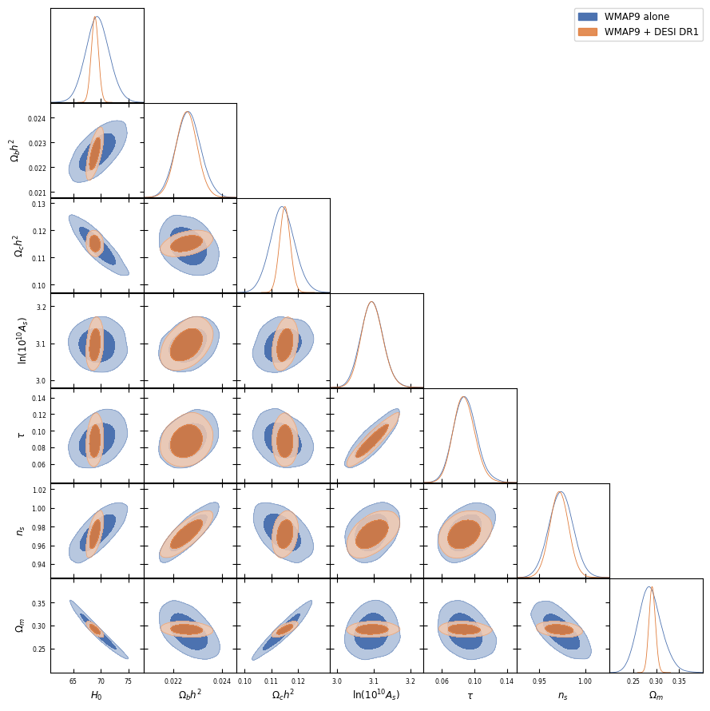
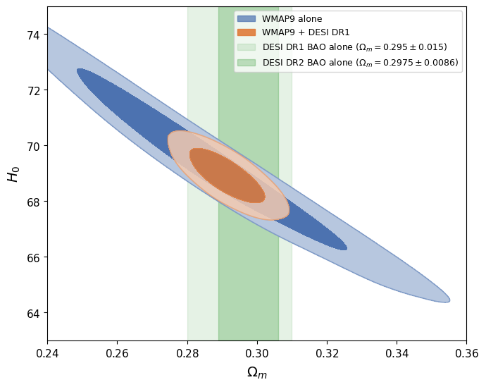
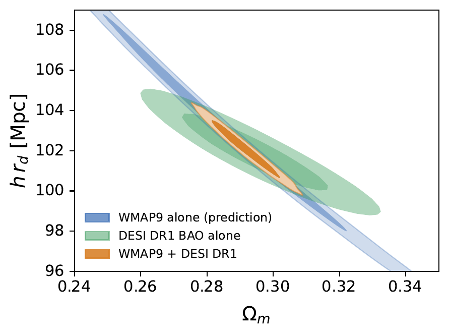

# WMAP9 + DESI DR1: ΛCDM without Planck

This repository performs a joint Bayesian analysis of flat ΛCDM using the WMAP nine-year CMB temperature likelihood and DESI DR1 baryon-acoustic-oscillation (BAO) measurements. Planck is intentionally excluded, so the resulting constraints provide an independent cross-check of the standard cosmological model.

The full analysis is implemented in reproducible Jupyter notebooks, from data loading and likelihood evaluation to MCMC sampling and publication-ready figures.

Maintained by [Cherian Parangot Ittyipe](https://github.com/Cherian-pi)
([@Cherian-pi](https://github.com/Cherian-pi)).

## Results

The joint WMAP9 + DESI DR1 fit uses 32 walkers for 3,000 MCMC steps and reaches Gelman–Rubin convergence with \( \hat{R} < 1.001 \).

| Parameter | Joint constraint |
|---|---|
| $H_0$ | 68.91 ± 0.65 km s⁻¹ Mpc⁻¹ |
| $Ω_m$ | 0.2914 ± 0.0071 |
| $Ω_b h^2$ | 0.02254 ± 0.00043 |
| $Ω_c h^2$ | 0.1151 ± 0.0020 |
| $n_s$ | 0.972 ± 0.010 |
| $\ln(10^{10}A_s)$ | 3.096 ± 0.029 |
| $τ$ | 0.088 ± 0.013 |



*Posterior distributions for the six sampled cosmological parameters and $\Omega_m$ , comparing the WMAP9-only fit (blue) with the joint WMAP9 + DESI DR1 fit (orange).*

## Interpretation

The largest improvement from adding DESI DR1 BAO is in  $\Omega_c h^2$ and $H_0$ . BAO provides an independent geometric constraint that breaks the degeneracy between the matter density and the expansion rate present in the CMB-only analysis.

The parameters $n_s$,  $ln(10^{10} A_s$), and  $\tau$  are largely unchanged, as expected: BAO measurements primarily constrain the expansion history and sound horizon, rather than the primordial perturbation spectrum or optical depth



*The $\Omega_m$ – $H_0$ plane for WMAP9 alone (blue) and WMAP9 + DESI DR1 (orange). Green bands show the 68% $\Omega_m$ ranges from DESI DR1 and DR2 BAO-only analyses.*

In the WMAP9-only case, the posterior exhibits an extended degeneracy ridge in the  $\Omega_m$ – $H_0$ plane. Adding DESI BAO substantially reduces this degeneracy: the \(H_0\) constraint becomes approximately three times tighter and shifts downward by roughly $0.5 \mathrm{km\,s^{-1}\,Mpc^{-1}}$.

No Planck-derived sound-horizon prior is used. WMAP9 independently determines the sound horizon through its acoustic-peak structure.



*The $\Omega_m$ – h $r_d$ plane, the primary BAO-sensitive parameter space. The WMAP9 prediction (blue) is consistent with the DESI DR1 BAO-only region (green), while the joint posterior (orange) lies in the overlap of the two constraints.*

## Figures

All figures are available in `figures/publication/`.

| Figure | Description|
|---|---|
| `getdist_wmap_vs_joint_corner` | Six-parameter posterior triangle, including \( \Omega_m \), for WMAP9 alone and the joint fit |
| `getdist_joint_corner` | Joint WMAP9 + DESI DR1 posterior with 68% credible intervals |
| `getdist_H0_Om_comparison` | \( \Omega_m \)–\(H_0\) plane with DESI DR1 and DR2 BAO-only bands |
| `concordance_Om_hrd` | \( \Omega_m \)–\(h r_d\) plane showing WMAP9, DESI BAO, and the joint posterior |
| `Om_comparison` | \( \Omega_m \) compared with CMB-only and BAO-based constraints |
| `wmap9_desi_joint_corrected_trace` | MCMC walker traces |
| `wmap9_desi_joint_corrected_comparison` | One-dimensional posteriors for \( \Omega_b h^2 \), \( \Omega_c h^2 \), and \(H_0\) |

## DESI Lyman-α Row Order

When loading the DESI DR1 anisotropic BAO mean files directly, note that the row ordering differs between tracers:

| Tracer | Row order |
|---|---|
| LRG1, LRG2, LRG3+ELG1, ELG2 | `DM_over_rs`, then `DH_over_rs` |
| Lyman-α | `DH_over_rs`, then `DM_over_rs` |
| BGS, QSO | Isotropic; a single `DV_over_rs` row |

If the data are read by row position rather than by the quantity label, the two Lyman-α values can be incorrectly swapped relative to the covariance matrix. This produces an artificially high DESI $\chi^2$.

The recommended approach is to read the mean values using their quantity labels. Notebook `03_desi_dr1_lcdm.ipynb` documents this issue and compares the fit before and after the correction.

## Getting Started

```bash
git clone [https://github.com/Cherian-pi/wmap9-desi-joint.git](https://github.com/Cherian-pi/wmap9-desi-joint.git)
cd wmap9-desi-joint
python -m venv .venv
source .venv/bin/activate
pip install -r requirements.txt

# Download the WMAP9 likelihood; it is not redistributed in this repository
./scripts/fetch_wmap_likelihood.sh
```

The WMAP nine-year likelihood code and associated data products, approximately 1 GB in total, must be downloaded from NASA LAMBDA. They are placed in `external/`, which is excluded from version control.

The likelihood is then compiled into `libwmap9.so`. Because this shared library is platform-dependent, it is not committed to the repository.


## Methodology

- **CAMB** computes the theoretical CMB temperature power spectrum.
- The **WMAP9 Fortran likelihood** is called from Python through a `ctypes`
  wrapper around `libwmap9.so`.
- **DESI BAO** measurements are incorporated as Gaussian likelihoods on the
  distance ratios for each tracer.
- **`emcee`** performs the MCMC sampling using the `DEMove` sampler.
- **GetDist** and **corner** generate the posterior and corner plots.

## Repository Structure

```text
notebooks/       01 data loading → 02 WMAP9 alone → 03 DESI DR1 ordering audit → 04 joint fit
data/bao/        DESI DR1 BAO mean and covariance files; see PROVENANCE.md
data/            WMAP9 nine-year TT spectrum
external/        Gitignored directory for third-party likelihood codes
scripts/         Helper script for downloading the WMAP9 likelihood
results/chains/  emcee chains (.npy) and run metadata (.json); superseded/ contains earlier runs
figures/         Publication figures
docs/            Notes on WMAP9 library symbols and data files
```

The notebooks are intended to be executed in numerical order.

## Scope

This repository covers:

- WMAP9-only flat ΛCDM constraints
- Joint WMAP9 + DESI DR1 flat ΛCDM constraints

It does not include:

- DESI-only cosmological fits
- Planck likelihood analyses
- DESI DR2 analyses

If the code does not build or a result cannot be reproduced, please open an issue.

## References

### Data

- Bennett, C. L., et al. 2013, *Nine-year WMAP observations: final maps and
  results*, ApJS, 208, 20.
- Hinshaw, G., et al. 2013, *Nine-year WMAP observations: cosmological parameter
  results*, ApJS, 208, 19.
- DESI Collaboration 2024, *DESI 2024 III: Baryon acoustic oscillations from
  galaxies and quasars*, arXiv:2404.03000.
- DESI Collaboration 2024, *DESI 2024 IV: Baryon acoustic oscillations from the
  Lyman-alpha forest*, arXiv:2404.03001.
- DESI Collaboration 2024, *DESI 2024 VI: Cosmological constraints from the
  measurements of baryon acoustic oscillations*, arXiv:2404.03002.

### Software

- Lewis, A., Challinor, A., & Lasenby, A. 2000, *Efficient computation of CMB
  anisotropies in closed FRW models* (CAMB), ApJ, 538, 473.
- Foreman-Mackey, D., Hogg, D. W., Lang, D., & Goodman, J. 2013, *emcee: the
  MCMC hammer*, PASP, 125, 306.
- Lewis, A. 2019, *GetDist: a Python package for analysing Monte Carlo samples*,
  arXiv:1910.13970.
- Torrado, J., & Lewis, A. 2021, *Cobaya: code for Bayesian analysis of
  hierarchical physical models*, JCAP, 05, 057.

### Related Work

- Pang, Y.-H., Zhang, X., & Huang, Q.-G. 2025, *Reevaluating H0 tension with
  non-Planck CMB and DESI BAO joint analysis*, JCAP, 04, 057
  (arXiv:2411.14189).

## License

The source code is released under the MIT License; see `LICENSE`.

The WMAP and DESI data products remain subject to the terms and conditions of
their respective collaborations.
