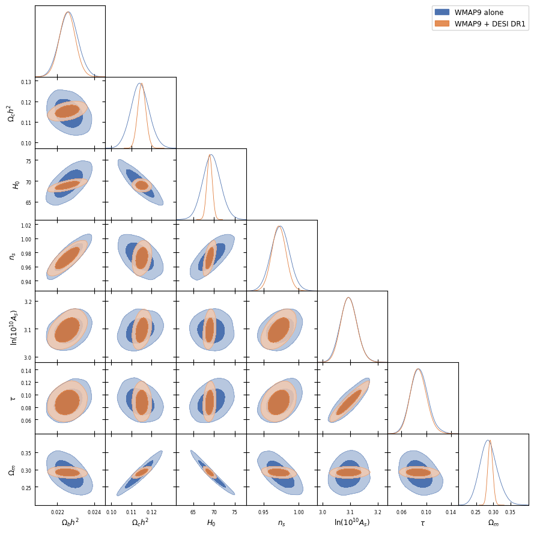

# WMAP9 + DESI DR1: a Planck-independent joint ΛCDM constraint

A reproducible MCMC pipeline that combines the WMAP nine-year CMB temperature
likelihood with DESI DR1 baryon acoustic oscillation measurements, deliberately
without Planck, to obtain an independent set of flat-ΛCDM parameter constraints.

**Author:** Cherian Parangot Ittyipe · [github.com/Cherian-pi](https://github.com/Cherian-pi)

---

## Results

Joint WMAP9 + DESI DR1 flat ΛCDM (32 walkers × 3000 steps, Gelman–Rubin R̂ < 1.001):

| Parameter | Joint constraint |
|---|---|
| $H_0$ | 68.91 ± 0.65 km s⁻¹ Mpc⁻¹ |
| $Ω_m$ | 0.2914 ± 0.0071 |
| $Ω_b h^2$ | 0.02254 ± 0.00043 |
| $Ω_c h^2$ | 0.1151 ± 0.0020 |
| $n_s$ | 0.972 ± 0.010 |
| $\ln(10^{10}A_s)$ | 3.096 ± 0.029 |
| $τ$ | 0.088 ± 0.013 |



All six sampled parameters and $Ω_m$, WMAP9 alone (blue) against the joint posterior
(orange). The contraction is concentrated in $Ω_ch^2$ and $H_0$, where BAO breaks the
CMB geometric degeneracy; $n_s, ln10^{10}A_s$ and τ are essentially unchanged, as
expected since BAO carries no information about them.

Adding DESI BAO to WMAP9 collapses the CMB-only geometric degeneracy: the long
$Ω_m–H_0$ ridge in the WMAP9-alone posterior shrinks to a compact contour
(`getdist_H0_Om_comparison`), tightening $H_0$ by roughly a factor of three while
shifting it downward by about 0.5 km s⁻¹ Mpc⁻¹. No Planck r_d prior is used
anywhere — WMAP9 calibrates the sound horizon through the acoustic peaks itself.

## Figures

All in `figures/publication/`.

| Figure | Content |
|---|---|
| `getdist_wmap_vs_joint_corner` | Six-parameter triangle plus $Ω_m$: WMAP9 alone vs WMAP9 + DESI DR1 |
| `getdist_joint_corner` | Joint posterior on its own, with 68% limits |
| `getdist_H0_Om_comparison` | The $Ω_m–H_0$ plane with the DESI DR1 and DR2 BAO-alone bands |
| `Om_comparison` | $Ω_m$ compared with CMB-only and BAO-based results |
| `wmap9_desi_joint_corrected_trace` | MCMC walker traces |
| `wmap9_desi_joint_corrected_comparison` | 1D posteriors of $Ω_b h^2$, $Ω_c h^2$, $H_0$ |

## The Lyman-α row-ordering issue

DESI DR1 stores its anisotropic BAO measurements in a per-tracer row order that
is **not uniform across tracers**:

- LRG1, LRG2, LRG3+ELG1, ELG2 → `DM_over_rs` first, then `DH_over_rs`
- **Lyman-α → `DH_over_rs` first, then `DM_over_rs`**
- BGS and QSO → isotropic, a single `DV_over_rs` row

A loader that assigns by row position rather than by the label column therefore
transposes the two Lyman-α observables against the covariance matrix, inflating
the DESI χ². The mean files must be read by their quantity label. Notebook
`03_desi_dr1_lcdm_corrected.ipynb` documents the diagnosis and the before/after
comparison.

## Layout

```
notebooks/      01 data loading → 02 WMAP9 alone → 03 DESI DR1 (ordering audit) → 04 joint fit
data/bao/       DESI DR1 mean + covariance files (see PROVENANCE.md)
data/           WMAP9 nine-year TT spectrum
external/       gitignored; third-party likelihood codes are fetched here
scripts/        download helper for the WMAP9 likelihood
results/chains/ emcee chains (.npy) and run metadata (.json); superseded/ holds the June run
figures/        publication figures
docs/           notes on the WMAP9 library symbols and data files
```

## Setup

```bash
git clone https://github.com/Cherian-pi/wmap9-desi-joint.git
cd wmap9-desi-joint
python -m venv .venv && source .venv/bin/activate
pip install -r requirements.txt

# fetch the WMAP9 likelihood (not redistributed here)
./scripts/fetch_wmap_likelihood.sh
```

The WMAP nine-year likelihood code and its data products (~1 GB) are not
committed. They are downloaded from NASA LAMBDA into `external/`, which is
gitignored, and compiled into `libwmap9.so` locally — the shared object is
platform-specific and is also not committed.

## Method

CAMB supplies the theory TT spectrum; the WMAP9 Fortran likelihood is called
through a ctypes wrapper around `libwmap9.so`; DESI BAO enters as a Gaussian
likelihood on the tracer-wise distance ratios. Sampling uses `emcee` with
`DEMove`; posteriors are plotted with GetDist and corner.

## Scope

This repository covers WMAP9-alone and WMAP9 + DESI DR1 joint constraints only.
DESI-alone fits, Planck likelihood work, and DESI DR2 exploration are
deliberately out of scope.

## References

Data
- Bennett, C. L., et al. 2013, *Nine-year WMAP observations: final maps and results*, ApJS, 208, 20
- Hinshaw, G., et al. 2013, *Nine-year WMAP observations: cosmological parameter results*, ApJS, 208, 19
- DESI Collaboration 2024, *DESI 2024 III: Baryon acoustic oscillations from galaxies and quasars*, arXiv:2404.03000
- DESI Collaboration 2024, *DESI 2024 IV: Baryon acoustic oscillations from the Lyman alpha forest*, arXiv:2404.03001
- DESI Collaboration 2024, *DESI 2024 VI: Cosmological constraints from the measurements of baryon acoustic oscillations*, arXiv:2404.03002

Software
- Lewis, A., Challinor, A., & Lasenby, A. 2000, *Efficient computation of CMB anisotropies in closed FRW models* (CAMB), ApJ, 538, 473
- Foreman-Mackey, D., Hogg, D. W., Lang, D., & Goodman, J. 2013, *emcee: the MCMC hammer*, PASP, 125, 306
- Lewis, A. 2019, *GetDist: a Python package for analysing Monte Carlo samples*, arXiv:1910.13970
- Torrado, J., & Lewis, A. 2021, *Cobaya: code for Bayesian analysis of hierarchical physical models*, JCAP, 05, 057

Related work
- Pang, Y.-H., Zhang, X., & Huang, Q.-G. 2025, *Reevaluating H0 tension with non-Planck CMB and DESI BAO joint analysis*, JCAP, 04, 057 (arXiv:2411.14189)

## License

Code: MIT (see `LICENSE`). WMAP and DESI data products remain under the terms
set by their respective collaborations.
